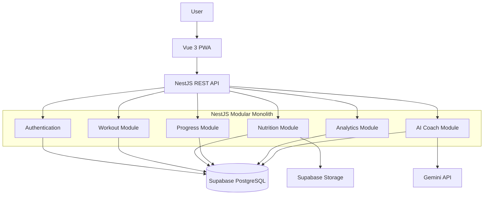

# FitCoach AI — System Architecture

**Status:** Initial proposal  
**Version:** 0.1.0  
**Project:** Personal fitness and nutrition assistant

## 1. Project Overview

FitCoach AI is a personal fitness application that combines workout planning, workout tracking, nutrition tracking, progress analytics and AI-powered coaching.

The application will initially be developed for personal use, with a focus on learning Vue 3 and NestJS while building a maintainable, secure and extensible system.

### Core capabilities

- Personalised workout planning and scheduling.
- Workout tracking, including sets, repetitions, weights and rest periods.
- Nutrition tracking through food photos, barcode scanning and manual entry.
- Calorie and macronutrient tracking.
- AI-powered fitness and nutrition recommendations.
- Progress tracking for weight, strength, running and nutrition.
- Light mode, dark mode and system appearance settings.

## 2. Architectural Principles

The project will follow these principles:

1. **Simplicity first:** Avoid unnecessary infrastructure and complexity.
2. **Modular design:** Separate responsibilities into well-defined modules.
3. **Security by default:** Protect personal data, credentials and API access.
4. **Type safety:** Use TypeScript across the frontend and backend.
5. **AI with boundaries:** AI provides recommendations; application code handles calculations and validation.
6. **User control:** AI must never modify a user's workout schedule without approval.
7. **Maintainability:** Prefer readable, testable code over premature optimisation.

## 3. High-Level Architecture

The project will use a modular monolith architecture.

The frontend communicates with a single NestJS backend API. The backend contains separate modules for workouts, nutrition, users, progress and AI coaching.

Supabase provides managed authentication, PostgreSQL database hosting and file storage.



## 4. Technology Stack

### Frontend

| Technology | Responsibility |
|---|---|
| Vue 3 | Frontend framework |
| TypeScript | Type safety |
| Vite | Development server and build tooling |
| Vue Router | Application navigation |
| Pinia | State management |
| Tailwind CSS | Styling |
| shadcn-vue | Reusable UI components |
| Reka UI | Accessible UI primitives |
| Lucide Vue | Icons |
| VueUse | Reusable Vue utilities |
| Apache ECharts | Progress and analytics charts |
| Vite PWA Plugin | Progressive Web App support |

The interface will follow an Apple-inspired design language, with responsive layouts, restrained colours, accessible typography and consistent spacing.

### Backend

| Technology | Responsibility |
|---|---|
| NestJS | Backend framework |
| TypeScript | Type safety |
| REST API | Frontend/backend communication |
| Prisma | Database ORM |
| PostgreSQL | Relational database |
| Supabase Auth | Authentication |
| Supabase Storage | Food images and user uploads |
| Gemini API | AI-powered coaching |
| Swagger | API documentation |
| Jest | Unit and integration testing |

### Infrastructure and tooling

| Technology | Responsibility |
|---|---|
| Git | Version control |
| GitHub | Source code hosting |
| GitHub Actions | CI/CD |
| Docker | Containerisation |
| Docker Compose | Local development infrastructure |
| PNPM | Package management and monorepo workspaces |

## 5. Monorepo Structure

The project will use a PNPM workspace monorepo.

```text
fitcoach-ai/
│
├── apps/
│   ├── web/                  # Vue 3 frontend
│   └── api/                  # NestJS backend
│
├── packages/
│   ├── shared-types/         # Shared TypeScript types
│   ├── domain/               # Shared domain definitions
│   └── validation/           # Shared validation schemas
│
├── docs/
│   └── architecture/
│       └── architecture.md
│
├── infrastructure/
│   └── docker/               # Infrastructure configuration
│
├── .github/
│   ├── workflows/
│   │   ├── ci.yml
│   │   ├── security.yml
│   │   └── deploy.yml
│   │
│   └── dependabot.yml
│
├── docker-compose.yml
├── pnpm-workspace.yaml
├── package.json
├── pnpm-lock.yaml
└── .gitignore
```

### Why a monorepo?

A monorepo keeps the frontend, backend and shared packages in one repository.

Benefits include:

- Shared TypeScript definitions.
- Easier coordination of frontend and backend changes.
- One dependency management strategy.
- One CI pipeline.
- Simpler local development.

Separate repositories and microservices are unnecessary for the initial scope.

## 6. Backend Module Design

The NestJS backend will be organised by business responsibility.

### Initial modules

| Module | Responsibility |
|---|---|
| Auth | Authentication and user identity |
| Users | Profile, preferences and fitness goals |
| Workouts | Workout plans, exercises and sessions |
| Nutrition | Meals, foods, calories and macros |
| Progress | Weight, measurements and performance |
| AI Coach | Recommendations and AI orchestration |
| Analytics | Progress calculations and summaries |

Each module should contain its own controllers, services, DTOs and related business logic where appropriate.

### Example module structure

```text
apps/api/src/
├── auth/
├── users/
├── workouts/
├── nutrition/
├── progress/
├── ai-coach/
├── analytics/
├── common/
├── database/
├── app.module.ts
└── main.ts
```

Modules should communicate through well-defined service interfaces rather than directly accessing one another's internal implementation.

## 7. AI Integration

The AI Coach will use the Gemini API through the NestJS backend.

The frontend must never communicate directly with the AI provider using a private API key.

### AI responsibilities

- Suggest workout adjustments.
- Analyse workout history.
- Provide recovery recommendations.
- Interpret nutrition trends.
- Provide guidance based on the user's goals.
- Summarise progress.

### Application responsibilities

The application—not the AI model—must calculate:

- Daily calorie totals.
- Protein, carbohydrate and fat totals.
- Workout volume.
- Running distance and pace.
- Weight changes.
- Personal records.

AI-generated food recognition and portion estimates must be presented to the user for confirmation before being saved.

AI workout recommendations must also require user approval before changing the schedule.

## 8. Database and Storage

Supabase will provide managed PostgreSQL and file storage.

Prisma will be used to define and manage the database schema.

### Initial data entities

- User
- UserProfile
- FitnessGoal
- Exercise
- WorkoutPlan
- WorkoutSchedule
- WorkoutSession
- ExerciseSet
- Food
- Meal
- MealItem
- NutritionEntry
- WeightEntry
- ProgressMeasurement
- AIRecommendation

Relationships and detailed fields will be defined during database modelling.

### Data access

- The backend will use Prisma for application database operations.
- Supabase Auth will handle user authentication.
- User-specific data must be protected through authorisation checks.
- Supabase Row Level Security should be configured as an additional protection layer where applicable.
- Uploaded food images should be stored in private storage buckets.

## 9. Security Architecture

Security will be implemented throughout development rather than added at the end.

### Security requirements

- Keep secrets in environment variables.
- Never commit `.env` files.
- Keep AI provider API keys on the backend.
- Validate incoming API requests.
- Enforce authentication and authorisation.
- Restrict CORS to trusted frontend origins.
- Use HTTPS in deployed environments.
- Apply database access controls.
- Avoid logging sensitive user information.
- Keep dependencies updated.

### Security tooling

| Tool | Purpose |
|---|---|
| Dependabot | Dependency update notifications |
| OSV-Scanner | Known dependency vulnerability scanning |
| Trivy | Container and configuration scanning |
| Gitleaks | Secret detection |
| Semgrep Community Edition | Static application security analysis |
| ESLint | Code quality and potential errors |

These tools will be introduced progressively rather than all being required before the first application feature is built.

## 10. CI/CD Architecture

GitHub Actions will be used for automated builds, testing and deployment workflows.

GitHub-hosted Ubuntu runners will execute workflows independently of the developer's local computer.

### Workflow files

```text
.github/workflows/
├── ci.yml
├── security.yml
└── deploy.yml
```

### Continuous Integration

The initial CI workflow will:

1. Check out the repository.
2. Set up Node.js.
3. Set up PNPM.
4. Install dependencies using the lockfile.
5. Run ESLint.
6. Run TypeScript checks.
7. Execute automated tests.
8. Build the frontend and backend.

### Security workflow

A separate workflow will progressively introduce:

- Dependency vulnerability scanning.
- Secret scanning.
- Static application security testing.
- Container scanning when container images are introduced.

### Deployment

Deployment automation will be introduced after the application has a working MVP.

Production secrets must be stored in GitHub Actions secrets or the relevant deployment provider's secret manager.

GitHub Actions usage and spending limits should be reviewed to avoid unexpected costs.

## 11. Local Development

Docker Compose will be used for local infrastructure where needed.

The frontend and backend can run independently during development.

Example local services:

```text
Vue frontend:       http://localhost:5173
NestJS API:         http://localhost:3000
API documentation:  http://localhost:3000/api/docs
```

Supabase hosted services will initially be used for authentication, database and storage. Local Supabase development can be introduced later if required.

## 12. Testing Strategy

Testing will be introduced alongside each feature.

| Test type | Purpose |
|---|---|
| Unit tests | Test individual services and business logic |
| Integration tests | Test interactions between modules and database |
| API tests | Verify endpoints and validation |
| Component tests | Verify Vue component behaviour |
| End-to-end tests | Verify complete user journeys |

Important business calculations, such as nutrition totals and workout volume, should have dedicated unit tests.

## 13. Development Roadmap

Development will proceed in small milestones.

| Milestone | Deliverable |
|---|---|
| 1 | Repository and monorepo setup |
| 2 | Vue and NestJS application foundations |
| 3 | GitHub Actions CI pipeline |
| 4 | Supabase authentication and database |
| 5 | User profile and fitness goals |
| 6 | Workout planning and tracking |
| 7 | Nutrition tracking |
| 8 | Progress analytics |
| 9 | AI Coach integration |
| 10 | PWA installation and polish |
| 11 | Security hardening and deployment |

Each milestone should result in working, testable functionality.

## 14. Architectural Decisions

| Decision | Selected approach | Reason |
|---|---|---|
| Architecture | Modular monolith | Simpler development and maintenance |
| Repository | PNPM monorepo | Shared types and coordinated development |
| Frontend | Vue 3 + TypeScript | Learn Vue with a maintainable stack |
| Backend | NestJS + TypeScript | Structured backend architecture |
| Database | PostgreSQL | Relational data and consistency |
| Database hosting | Supabase | Managed infrastructure |
| ORM | Prisma | Type-safe database access |
| Authentication | Supabase Auth | Managed authentication |
| AI | Gemini API | AI integration through backend |
| CI/CD | GitHub Actions | Hosted runners and GitHub integration |
| Deployment | To be decided | Choose when the MVP is ready |

## 15. Future Considerations

The following are intentionally excluded from the initial implementation:

- Microservices.
- Kubernetes.
- Kafka.
- Redis.
- Complex event-driven infrastructure.
- Paid subscriptions and monetisation.
- Multiple AI providers.
- Native iOS and Android applications.

These can be reconsidered when real requirements justify the added complexity.

---

**Architecture principle:** Build the simplest secure system that supports the current requirements, while keeping the code organised enough to evolve as FitCoach AI grows.
